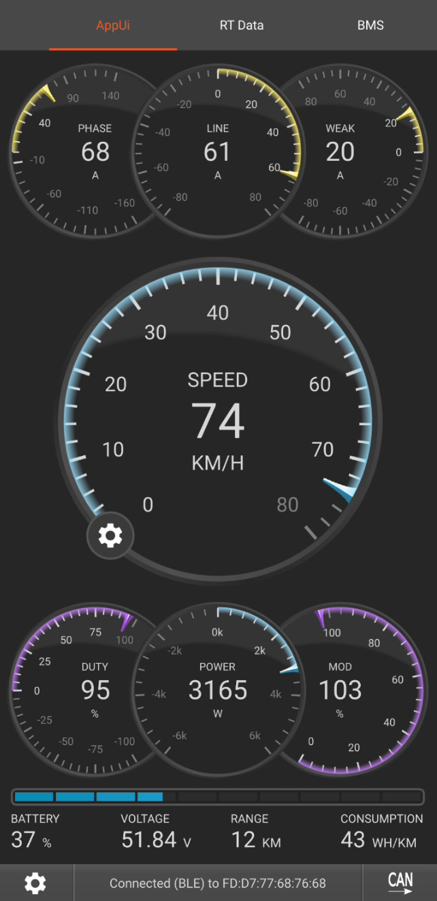
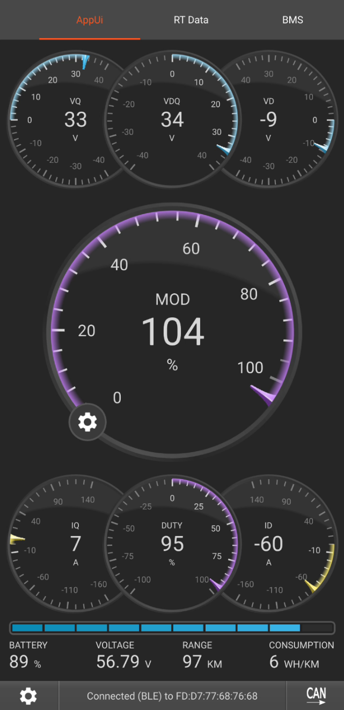
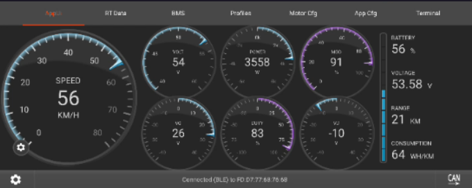

Repository: [vesc-dashboard](https://github.com/POP303U/vesc-dashboard)\
Inspired by: https://vesc-project.com/node/3641

This is a custom QML dashboard for VESC Tool built around reusable gauge definitions and presets instead of a fixed layout.

I made this because i felt like the default VESC RT-Data tab was pretty much useless in terms of monitoring actually important stats.

# Preview

Layout **Default** (loaded by default):



Layout **FOC** (advanced parameters):



Landscape Preview (**Voltage**):



# Telemetry limitation

The normal VESC `COMM_GET_VALUES` path is nice for a dashboard, but isn't practical for real debugging.

Several motor/FOC values are averaged, then returned and a dashboard refresh is much slower than the FOC control loop.

What you can do though is:
- correlate behavior with speed, duty and modulation
- see if overmodulation/field weakening brings any return
- what you are truly limited by (amps/volts)

# Gauge architecture

The UI is built around:

- `gaugeIds` / `gaugeNames`
- preset objects
- live telemetry properties
- `gDef()` gauge definitions
- the normal `valuesReceived` telemetry handler

This makes implementing new gauges incredibly easy.

New presets can be easily done too, the FOC preset is represented as:

```qml
{ 
    name: "FOC",
    main: "mod",
    slots: ["vq", "vdq", "vd", "iq", "duty", "id"] 
}
```

# Related guide

For the motor-control concepts behind these gauges, see [[Advanced VESC Tuning Guide]].
